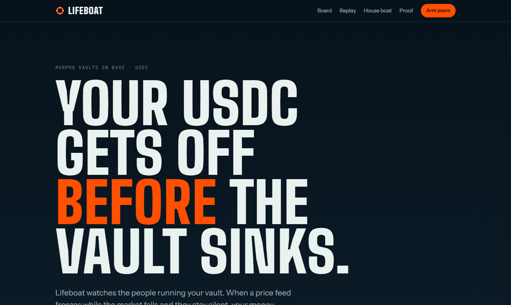
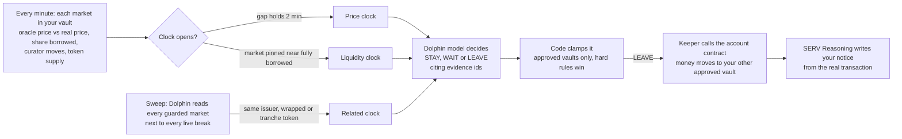

<p align="center">
  
</p>

<h1 align="center">Lifeboat</h1>

<p align="center"><b>Your USDC gets off before the vault sinks.</b></p>

<p align="center">
  <a href="https://lifeboat.jdollar.site"></a>
  
  
  
  
</p>

<p align="center">
  <a href="https://lifeboat.jdollar.site"><b>Open the live app</b></a> ·
  <a href="https://lifeboat.jdollar.site/replay">Replay March 22</a> ·
  <a href="https://lifeboat.jdollar.site/proof">Proof</a>
</p>



Your USDC earns yield in a Morpho vault. Every vault lends into markets that trust a price feed for their collateral. When that feed keeps an old price while the real market crashes, borrowers post the broken token at the stale price and drain the lenders. The people running your vault, its curators, can stop it by cutting the market. Lifeboat watches them. **If they act, you stay and keep earning. If they go quiet, an open model on Dolphin decides to pull your money out and park it in a vault you approved.** Only you can ever take it out.

## Why this matters

On March 22 2026 a compromised key minted about 80 million unbacked Resolv USR. Morpho markets kept pricing wstUSR at **$1.1330** for the whole incident while it traded at a fraction of that. In one market that had **$4,053** borrowed, borrowers pulled **$6,244,125** in 133 transactions and it was fully borrowed **42 minutes** after the price broke. Across the five affected markets, **$10.8M** of vault money was still stuck two days later. One curator got its vault out in 23 minutes; others took hours or days.

**Replayed through the live code on Dolphin, a $1,000 depositor in each of the 10 exposed vaults is out by 02:59 UTC, 33 minutes after the first break, with the money actually withdrawable at that moment.** In the seven RLP positions Lifeboat moves before RLP's own price feed shows anything. Curators in those same vaults took between 6 minutes and 30 hours to make their first move.

Every number above is read onchain at the historical block. See [`data/replay`](data/replay).

## Try it in a minute (no wallet needed)

| Do this | You will see |
|---|---|
| Open the [board](https://lifeboat.jdollar.site/#board) | The biggest USDC vaults on Base, each market with its oracle price, real market price, gap, share borrowed and the curator's last onchain move. Live. |
| Paste any Morpho vault address into the box | The same reading for that vault, with where every number comes from one tap away. |
| Open [Replay March 22](https://lifeboat.jdollar.site/replay) | The real oracle, market price, utilization and every curator transaction from that day, with the moment Lifeboat decides and the moment its exit could actually fill. Switch to Stream, November 2025. |
| Press **Run a fire drill** on the house boat | A real Lifeboat account on Base with real USDC. The agent moves it between its two approved vaults in one mainnet transaction, and SERV Reasoning writes the notice a user would get. Basescan link on screen. |
| Connect a Base wallet in [Arm yours](https://lifeboat.jdollar.site/app) | Create your own account with $1 or more, pause the agent, pull out to your wallet whenever you like. |

## How it works



| Step | Who decides |
|---|---|
| Reading prices, utilization, curator events, token supply | Code, onchain and public sources |
| Opening a clock | Code (gap held for two minutes, or a market pinned near fully borrowed) |
| Linking a calm market to a break elsewhere | Dolphin model (the sweep). A price feed cannot see this. |
| Stay, wait or leave, and where to park | Dolphin model, every reason tied to an evidence id |
| Final say | Code. Hard rules override the model: a 25% gap with 30 minutes of curator silence, a market 95% borrowed, a model down for 10 minutes. |
| Moving money | The account contract. The agent can only move USDC between vaults you approved, or into your account. |
| Taking money out | Only you, any time, no notice |

**The sweep** is the part a rule cannot do. On March 22 the price feed for RLP, Resolv's liquidity provider token, showed no gap until 03:39 UTC. But its sister tokens USR and wstUSR had been collapsing since 02:27. The sweep reads every market Lifeboat guards next to every live break and links tokens by issuer, wrapping or tranche. In the replay it linked RLP to USR at 02:40, an hour before RLP's own feed moved.

## Why only on Dolphin

The core act is a personalized decision to pull one person's money out of one named investment product and put it in another. [Anthropic's Usage Policy](https://www.anthropic.com/legal/aup) treats that as a high risk recommendation that a qualified person must review before it is acted on, so an unattended agent cannot run it on Claude as built. Lifeboat runs the decision on **DeepSeek V4.1 Flash, open weights served by Dolphin**, over a standard API, so the model can move to any node that serves the same weights.

It is also the only way the economics work. Lifeboat reads a full evidence pack for every open clock every minute and sweeps every guarded market whenever a break appears anywhere. At Dolphin's price of **$0.01 per million input tokens** that is nearly free: the whole March 22 replay, 10 decisions and the sweeps, cost **$0.001** on Dolphin, recorded per call in [`data/replay/decisions.json`](data/replay/decisions.json).

## Where SERV Reasoning is used

SERV Reasoning writes the notice a person reads after every action Lifeboat takes, live and in the fire drill. Code writes the first sentence from the transaction itself (what moved, from where, to where, with the Basescan link), so a model can never misstate where your money went. SERV explains why, from the decision's own reasons. Every notice records the model that wrote it.

## Live on Base mainnet

| What | Address or transaction |
|---|---|
| Factory | [`0xdeb5BDF6BADaFBdE806a86B385CFf14d05dCeaDE`](https://basescan.org/address/0xdeb5BDF6BADaFBdE806a86B385CFf14d05dCeaDE) |
| Account implementation | [`0x35810276c5937ADA331F50986aB27a23A14AC237`](https://basescan.org/address/0x35810276c5937ADA331F50986aB27a23A14AC237) |
| House boat (public demo account) | [`0x22cC997126756D77a4f7BDb687867BCF3D54644b`](https://basescan.org/address/0x22cC997126756D77a4f7BDb687867BCF3D54644b) |
| Keeper (the agent's signer) | [`0xF336572d3efE34dab09730449dC53ca294c94e03`](https://basescan.org/address/0xF336572d3efE34dab09730449dC53ca294c94e03) |
| Approved vaults | Steakhouse USDC [`0xbeeF…8183`](https://basescan.org/address/0xbeeF010f9cb27031ad51e3333f9aF9C6B1228183), Gauntlet USDC Prime [`0xeE8F…4b61`](https://basescan.org/address/0xeE8F4eC5672F09119b96Ab6fB59C27E1b7e44b61) |
| First fire drill | [`0x85f0…e263`](https://basescan.org/tx/0x85f02b7d016d8fb8d4ead01032e40dd8706eec0fa80112a499c612a909f3e263) |
| First drill from the website, with SERV notice | [`0xba82…7bc7`](https://basescan.org/tx/0xba82c2f68c06cf97441032650e055e759f6bd13259452c51054dbe6a56f07bc7) |

Launch transactions are recorded in [`data/launch.json`](data/launch.json). The watcher runs every minute on the live server and guards the house boat and every account created through the factory.

## Claims you can check

| Claim | Check it |
|---|---|
| The agent can never take your money | [`LifeboatAccount.sol`](contracts/src/LifeboatAccount.sol): the keeper can only `deposit` into an approved vault, `exit` to the account, or `move` between them. 9 fork tests against Base mainnet in [`contracts/test`](contracts/test). |
| Exit works while the feed is frozen | Morpho's withdraw path has no oracle check. The fire drill transactions above are real exits. |
| Hard rules beat the model | [`policy.ts`](engine/src/decide/policy.ts) `clamp()`, 48 tests in [`policy.test.ts`](engine/src/decide/policy.test.ts) and [`engine/test`](engine/test) |
| The model cannot invent evidence | `validateModel()` rejects any reason citing an evidence id that is not in the pack |
| A failed read is never treated as curator silence | `curatorUnknown` in [`policy.ts`](engine/src/decide/policy.ts) and [`watcher.ts`](engine/src/watcher.ts) |
| Every decision is published | `/api/decisions` and `/proof`: evidence, model, tokens, cost, hash, transaction |
| Replay numbers are real | [`data/replay`](data/replay): every sample has its block and source |

## Run it yourself

```bash
# contracts (Foundry), fork tests against Base mainnet
cd contracts && forge install --no-git foundry-rs/forge-std OpenZeppelin/openzeppelin-contracts && forge test

# engine: decision policy, sweep, watcher, keeper
cd engine && npm ci && npx vitest run

# replay March 22 through the live code (needs DOLPHIN_API_KEY, optional SERV_API_KEY)
cd engine && npx tsx scripts/replay.ts

# app + watcher
cd app && npm ci && npm run build && cd .. && node scripts/serve.mjs
```

Environment: `DOLPHIN_API_KEY`, `SERV_API_KEY`, `KEEPER_PK` (server only), `FACTORY`, `FACTORY_BLOCK`, `HOUSE_ACCOUNT`, `APPROVED_VAULTS`, `DATA_DIR`, `BASE_RPC_URL`.

## Repo map

| Path | What |
|---|---|
| [`contracts/`](contracts) | `LifeboatAccount` (one per user) and `LifeboatFactory` |
| [`engine/src/decide/`](engine/src/decide) | clocks, evidence pack, Dolphin call with one repair turn, clamp, sweep, notices |
| [`engine/src/watcher.ts`](engine/src/watcher.ts) | the minute loop that reads, decides and moves |
| [`engine/src/keeper.ts`](engine/src/keeper.ts) | the signer, with a cross process lock |
| [`engine/scripts/replay.ts`](engine/scripts/replay.ts) | replays real incidents through the live code |
| [`app/`](app) | Next.js app: board, vault pages, replay, house boat, arm your own, proof |
| [`data/replay/`](data/replay) | Resolv (Mar 22 2026) and Stream (Nov 2025) incidents, read onchain |

## Business

Planned fee: 10% of the yield earned while armed, taken when you withdraw. Not charged during the hackathon. A lender who would have lost a deposit in one of these incidents pays for years of it in a single save. The curator response record Lifeboat builds as a side effect, how fast each curator really acts, is a product of its own for allocators.

## Scope

Live accounts are on Base, with USDC, across Morpho vaults the owner approves. Replays use Ethereum, Base and Arbitrum mainnet data. Lifeboat cannot pull money out of a market that is already fully borrowed; the replay shows exactly what was withdrawable when.

## License

MIT
